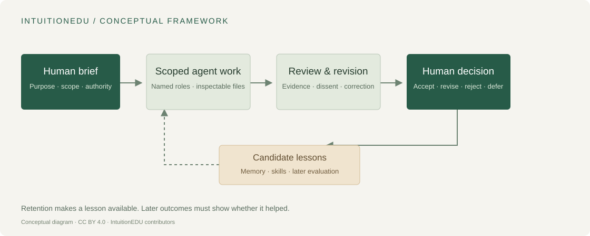

# IntuitionEDU

**A framework for human-directed agent teams in teaching and research.**

IntuitionEDU explores how a small team of AI agents can support academic work while keeping human judgment, traceable evidence and correction central to the process. The project connects course design and research workflows through shared practices: clear briefs, scoped responsibilities, review, revision, and explicit human decisions.

This public repository contains the **framework and tech-stack documentation**. It is an early documentation release, not a runnable distribution of the private system or a release of study results. It does not demonstrate that agents learn reliably or that multi-agent work outperforms other approaches.

## Start here

| If you want to understand… | Read… |
| --- | --- |
| The purpose and boundaries | [Project overview](docs/overview.md) |
| The central ideas | [Conceptual framework](docs/conceptual-framework.md) |
| How the parts fit together | [Architecture](docs/architecture.md) |
| The underlying technology | [Tech stack](docs/tech-stack.md) |
| How a task moves through the team | [Workflow](docs/workflow.md) |
| Memory, reflection and reusable skills | [Memory and learning](docs/memory-and-learning.md) |
| What would count as evidence of improvement | [Evaluation](docs/evaluation.md) |
| What is available for reproduction | [Availability and reproducibility](docs/reproducibility.md) |

The diagram describes the intended workflow. A saved reflection or a completed job is not proof that a decision was correct or that a lesson transfers to later work.

## Scope of this release

Included: newly written public descriptions of the framework, technology, evaluation approach and release boundaries.

Excluded: live agent instructions and memories, credentials, deployment settings, conversations, private teaching records, datasets, unpublished abstracts, proposals, study results and third-party manuscripts. No private repository history is included.

See [release scope](docs/release-scope.md), [project status](docs/status.md) and [third-party notices](THIRD_PARTY_NOTICES.md).

## Project and citation

Maintained by the **IntuitionEDU project**. This repository is the public companion to an actively developed project. It does not grant access to the private development workspace.

Repository: <https://github.com/weiaiwayne/intuitionist-edu-public>

Use [CITATION.cff](CITATION.cff) and the [citation guide](CITATION.md). For manuscripts, cite the specific public commit or release you used; an archival DOI should be added only after an archive has actually been created.

## Licenses

Original documentation and diagrams: **CC BY 4.0**. Any original code expressly included in this public repository: **MIT**. These licenses do not apply to excluded private materials or external dependencies. See [LICENSE](LICENSE) for the exact division.
